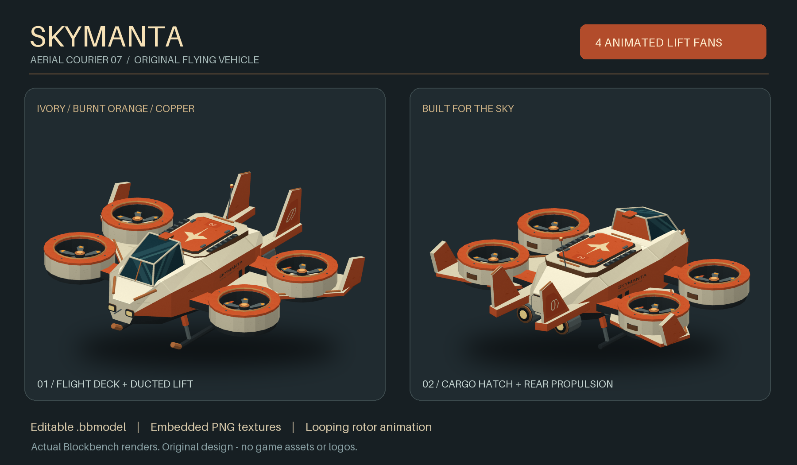

# Blockbench assets: Chests & SkyManta

## SkyManta - original flying vehicle

[Download SkyManta (ZIP)](https://github.com/GogoAllukeijo/fortnite-chest-blockbench/raw/refs/heads/main/SkyManta.zip)



An original ivory-and-orange aerial courier with four animated lift fans,
a panoramic cockpit, cargo hatch, twin tail fins and landing skids.
No bus, balloon, Fortnite branding or extracted game assets.
Open `SkyManta.bbmodel`, then **Animate > rotors_spin > Play**.
See [SkyManta_README.md](SkyManta_README.md) for usage and regeneration instructions.
Flight physics and controls are not included; this is an editable visual asset.

## Regular_chest & Epic_chest

Original, stylized wooden loot chest inspired by colorful adventure games.
Not an official Fortnite asset and not extracted from any game.

## Lataa / Download

### Regular_chest

[Download Regular chest + textures (ZIP)](https://github.com/GogoAllukeijo/fortnite-chest-blockbench/raw/refs/heads/main/Regular_chest.zip)


- `Regular_chest.bbmodel` - closed chest.
- `Regular_chest_open.bbmodel` - the same chest with its lid opened 105 degrees.
- `chest_atlas.png` - hand-authored procedural 512 x 512 wood, brass and treasure atlas.
- `Regular_chest_loot.png` - 512 x 320 painted coin-and-gem pile filling the opening.
- `preview.png` - both actual models rendered in Blockbench.

### Epic_chest

[Download Epic chest + textures (ZIP)](https://github.com/GogoAllukeijo/fortnite-chest-blockbench/raw/refs/heads/main/Epic_chest.zip)


- `Epic_chest.bbmodel` - closed Epic chest.
- `Epic_chest_open.bbmodel` - open Epic chest.
- `epic_chest_atlas.png` - embedded 512 x 512 Epic texture atlas.
- `Epic_chest_loot.png` - 512 x 320 gold, amber and ruby treasure pile.
- `epic_preview.png` - both Epic poses rendered in Blockbench.

Epic uses rich plum-purple wood, warm champagne-gold hardware, burgundy lining
and amber/ruby treasure. There are no blue surfaces or light beams.
It preserves Regular's geometry, hinge, editing groups and level of detail.
Both variants keep their exterior design and colors. Each ZIP contains only its own variant.

**Suomeksi:** Pura ZIP ja avaa haluamasi `.bbmodel` Blockbenchissa kohdasta
File > Open Model. Tekstuurit ovat valmiiksi mallin sisalla. Molemmat mallit
ovat muokattavia. Valopilari on poistettu kokonaan.

Open either `.bbmodel` with **File > Open Model** in Blockbench 4.10 or newer.
Textures are embedded: no relinking or plugins are needed.
These are **Generic Model** projects containing cubes and meshes, not direct
Minecraft Java/Bedrock exports. Game-specific conversion requires a suitable
exporter and may require geometry changes.

## Model details

The closed and open files of each variant share geometry, textures, contents and editing groups.
Only the `lid` group's rotation differs. Its rear hinge pivot is `[0, 12, -8.6]`;
set its X rotation to `0` to close it or `-105` to open it.

- Wide oak body with individual grain-textured boards, an actual floor and hollow interior.
- Thin, faceted barrel lid with an inner lining, end panels and continuous brass straps.
- Brass edging, corner guards, rivets, a recessed keyhole, hinges and two drop handles.
- A dense, painted PNG treasure surface just below the rim, over a solid interior fill.
- No beam, opaque glow column or oversized ornament on the lid.

The `treasure` group can be hidden or removed for an empty chest.
The textures use painted highlights, not an emissive shader.
The old individual coin stacks have been replaced by a single lightweight `treasure_fill`
element. Its upper face displays the complete loot PNG without tiling. The texture is
embedded in both poses and also included separately in the ZIP for editing.
Its UV canvas is 512 x 512, mapping the entire 512 x 320 image onto the rectangular opening.

## Regenerate

Use Python 3.10+ from any working directory:

```sh
python -m pip install -r requirements.txt
python gen.py
python -m unittest -v test_models.py
```

The generator writes beside itself, uses fixed seeds and stable UUIDs, and
rebuilds each variant's ZIP with its two models, atlas, loot PNG, saved preview and this README.
Previews are captured separately in Blockbench; the generator does not rerender them.
